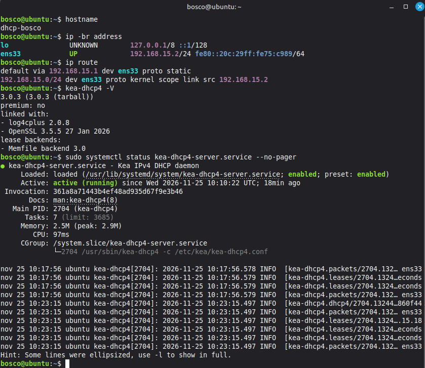
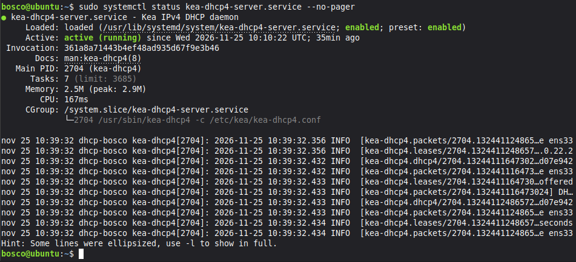
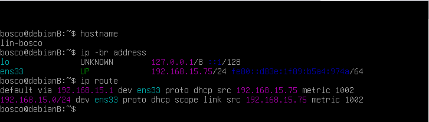
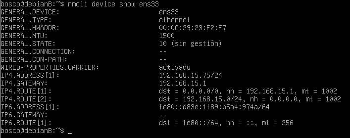
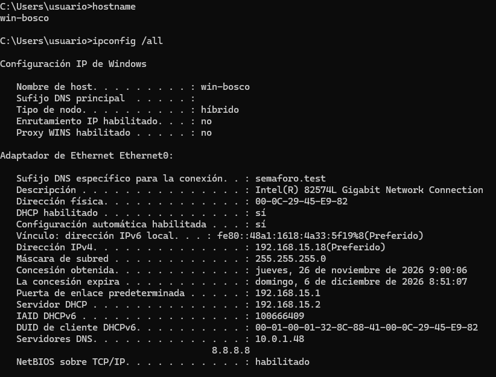
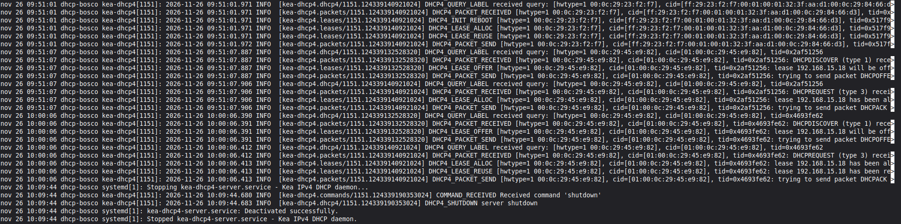
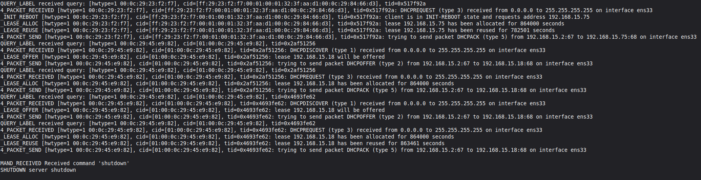
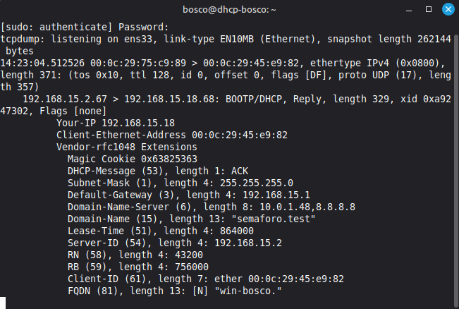
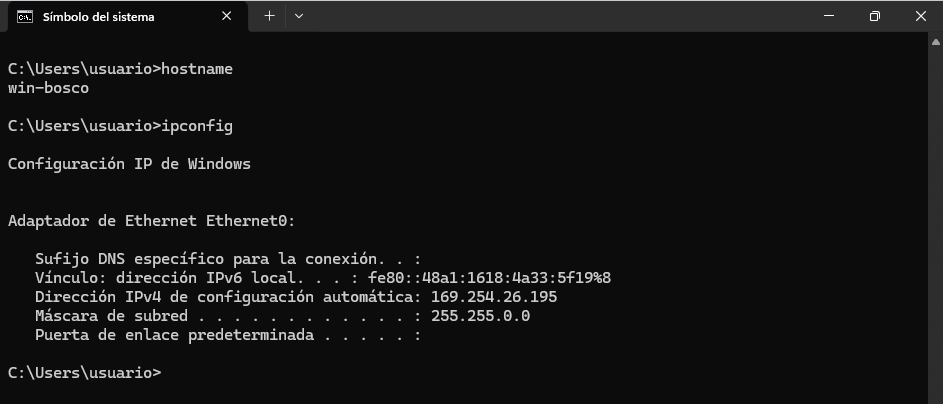

# UT2 · Servicio DHCP de Autoescuela Semáforo

| Dato | Valor |
|---|---|
| Nombre | Bosco Pérez Sañudo |
| Nº de orden | 15 |
| Empresa | Autoescuela Semáforo |
| Dominio | semaforo.test |

> Rellena los huecos y sustituye los textos entre `< >`. No cambies el orden de los apartados: es el mismo que el de la lista de cotejo.

## Plan de direcciones

| Equipo | Hostname | MAC | Dirección IP | Cómo la obtiene |
|---|---|---|---|---|
| Router pfSense (LAN) | — | 00:0C:29:CE:67:B5 | 192.168.15.1 | Manual |
| Servidor DHCP | dhcp-bosco | 00:0C:29:75:C9:89 | 192.168.15.2 | Manual (fija) |
| Equipo de dirección (Windows) | win-bosco | 00:0C:29:45:E9:82 | 192.168.15.18 | Reserva |
| Puesto de trabajo (Linux) | lin-bosco | 00:0C:29:23:F2:F7 | 192.168.15.75 | Dinámico |

| Parámetro | Valor |
|---|---|
| Pools | .75 – .175  |
| Exclusión |.125 – .134 |
| Concesión / T1 / T2 (s) | 43200 |
| DNS del equipo de dirección | 8.8.8.8 |

## 1. Instalación del servidor · CE 2.c

**Qué demuestra:** Esta captura muestra las configuraciones del servidor DHCP

## 2. Configuración básica · CE 2.d

La configuración completa está en [kea/kea-dhcp4.conf](kea/kea-dhcp4.conf).

**Qué demuestra:** Valida los errores que pudiera haber en el archivo de configuración

**Qué demuestra:** Muestra las redes del cliente linux

**Qué demuestra:** Muestra la configuracion de la targeta de red (ens33)

## 3. Asignaciones dinámicas y estáticas · CE 2.e

**Qué demuestra:** La configuración basica del Windows cliente

**Qué demuestra:** el journalctl de los registros de asignación de ayer 25/11/2026

## 4. Opciones adicionales · CE 2.f

Se comprueban en `kea-dhcp4.conf` (con el comentario junto a la reserva), E4 y E5. No hace falta nada más aquí.

## 5. Así funciona una solicitud · CE 2.b

**Qué demuestra:** que el windows recibe la ip designada despues del renew

| Mensaje | IP origen | MAC origen | IP destino | MAC destino | Difusión o unicast |
|---|---|---|---|---|---|
| DISCOVER | 0.0.0.0 | 00:0c:29:45:e9:82 | 255.255.255.255 | ff:ff:ff:ff:ff:ff | Difusión |
| OFFER | 192.168.15.2 | 00:0c:29:75:c9:89 | 192.168.15.18 | 00:0c:29:45:e9:82 | Unicast |
| REQUEST | 0.0.0.0 | 00:0c:29:45:e9:82 | 255.255.255.255 | ff:ff:ff:ff:ff:ff | Difusión |
| ACK | 192.168.15.2 | 00:0c:29:75:c9:89 | 192.168.15.18 | 00:0c:29:45:e9:82 | Unicast |

- **xid:** 0xa9247302
- **Identificador del servidor:** 192.168.15.2

**Renovación y caducidad** (con tus tiempos, 3 o 4 líneas): 43200seg, a los 21600seg el cliente intenta renovar en unicast directamente con 192.168.15.2. Si no obtiene respuesta, a los 37800seg pide renovación por difusión a cualquier servidor DHCP de la red. Si llega a los 43200 s sin renovar, la concesión caduca, pierde la IP y vuelve a empezar con un DISCOVER (o cae en APIPA 169.254.x.x).

## 6. Informe para la empresa · CE 2.a

**Tres ventajas para Autoescuela Semáforo:**

1. Eliminación de conflictos de IP (IP duplicadas)
2. Movilidad interna sin pérdida de red
3. Conectividad inmediata y segura para visitantes/alumnos

| Mecanismo | Cómo obtiene el equipo su IP | Qué equipo de la oficina lo usa (en APIPA, cuándo aparece) |
|---|---|---|
| Configuración manual | El administrador la introduce a mano en la interfaz de red junto con máscara, puerta de enlace y DNS. | pfSense (192.168.15.1) y servidor Kea (192.168.15.2), que necesitan dirección fija desde el arranque. |
| DHCP dinámica | El cliente solicita IP por red y el servidor Kea le presta una libre del pool durante el tiempo de concesión (43200 s). | Puestos de trabajo generales (lin-bosco, en el rango .75-.175 excluyendo .125-.134) y equipos de visitantes/alumnos. |
| Reserva DHCP | El servidor Kea asigna siempre la misma IP configurada identificando al cliente por su dirección MAC. | Equipo de dirección (win-bosco, con la IP 192.168.15.18). |
| APIPA (169.254.26.195) | El propio sistema operativo se autoasigna una IP del rango 169.254.0.0/16 (sin puerta de enlace) tras comprobar que no hay conflicto ARP. | Aparece cuando el cliente está configurado por DHCP y no recibe respuesta del servidor (por ejemplo, con Kea detenido o fallo en el servicio/red). |

**Por qué el router y el servidor DHCP no usan DHCP:**

**Qué demuestra:** que la maquina windows no recibe la ip designada con el kea apagado

## 7. Uso de IA

- [ ] No he usado IA en esta tarea.

| Herramienta | Para qué la usé | Qué comprobé o corregí yo |
|---|---|---|
| gemini | automatizar el .conf del kea | algun dato mal que no coincidia con los numeros designados|
